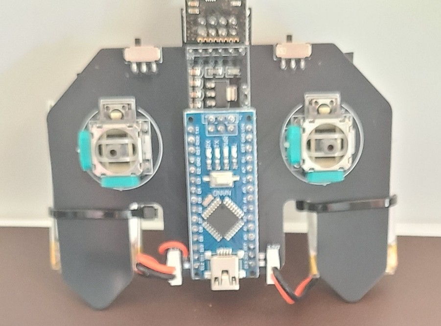
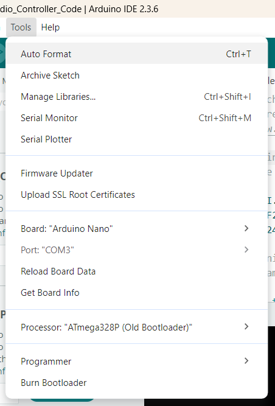

# BrushQuadX RF24 TX Controller

Arduino transmitter firmware for the BrushQuadX brushless quadcopter controller. It reads four joystick axes and two auxiliary switches, converts them to byte-sized channel values, and sends the payload over an nRF24L01 radio link.

## Current implementation

- RF24 data rate: `250KBPS`
- Auto-acknowledgement: disabled
- Writing pipe: `0xE8E8F0F0E1`
- RF24 pins (V2): CE `D9`, CSN `D10`
- Serial monitor: `9600 baud`
- Payload: six bytes (`MyData`), in this order:
	`throttle`, `yaw`, `pitch`, `roll`, `AUX1`, `AUX2`

The receiver must use the same writing pipe/address, RF24 data rate, and payload field order. Because auto-acknowledgement is disabled, the transmitter does not confirm delivery or retry packets.

## V2 wiring

| Function | Arduino pin | Firmware behavior |
| --- | --- | --- |
| Yaw joystick | `A0` | Inverted and mapped to `0..255` |
| Throttle joystick | `A1` | Inverted and mapped to `0..255` |
| Roll joystick | `A2` | Inverted and mapped to `0..255` |
| Pitch joystick | `A3` | Inverted and mapped to `0..255` |
| AUX1 switch | `D2` | `INPUT_PULLUP`, transmitted as a digital byte |
| AUX2 switch | `D3` | `INPUT_PULLUP`, transmitted as a digital byte |
| nRF24L01 CE | `D9` | RF24 constructor pin |
| nRF24L01 CSN | `D10` | RF24 constructor pin |

Connect the nRF24L01 SPI signals to the board's hardware SPI pins. The exact SPI pins depend on the Arduino board.

## Joystick mapping

Each analog input is constrained to `0..1023`, split at its calibrated center, and mapped to `0..255`. The active code uses inverted output and these center values:

| Channel | Input | Center |
| --- | --- | ---: |
| Throttle | `A1` | `516` |
| Yaw | `A0` | `523` |
| Pitch | `A3` | `527` |
| Roll | `A2` | `490` |

At startup, the payload is initialized to throttle `0`, AUX channels `0`, and joystick centers `127`. In the loop, all six fields are refreshed and one packet is written on every iteration.

## Build and upload

1. Open `BrushQuadX_RF24_TXController/BrushQuadX_RF24_TXController.ino` in the Arduino IDE.
2. Install the `RF24` library and select the target Arduino board and port.

    

3. Verify the active V2 wiring above.
4. Upload the sketch.

The sketch contains commented V1 pin mappings for reference, but those mappings are not active.

## Credits and sources

- **Original implementation and release:** Electronoobs — [YouTube channel](https://www.youtube.com/channel/UCjiVhIvGmRZixSzupD0sS9Q)
- **Video/source reference:** Max Imagination — [video](https://youtu.be/Sa6EslOHsI0?si=nNmNhNQq2Uk0lRPZ)
- **Shared source file:** [Google Drive folder](https://drive.google.com/drive/folders/1w5g0VESJpkFj575870XyaX4Fom3dVHSc)
